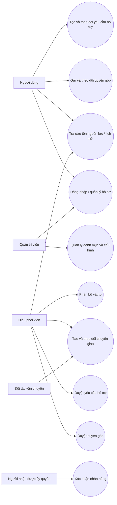
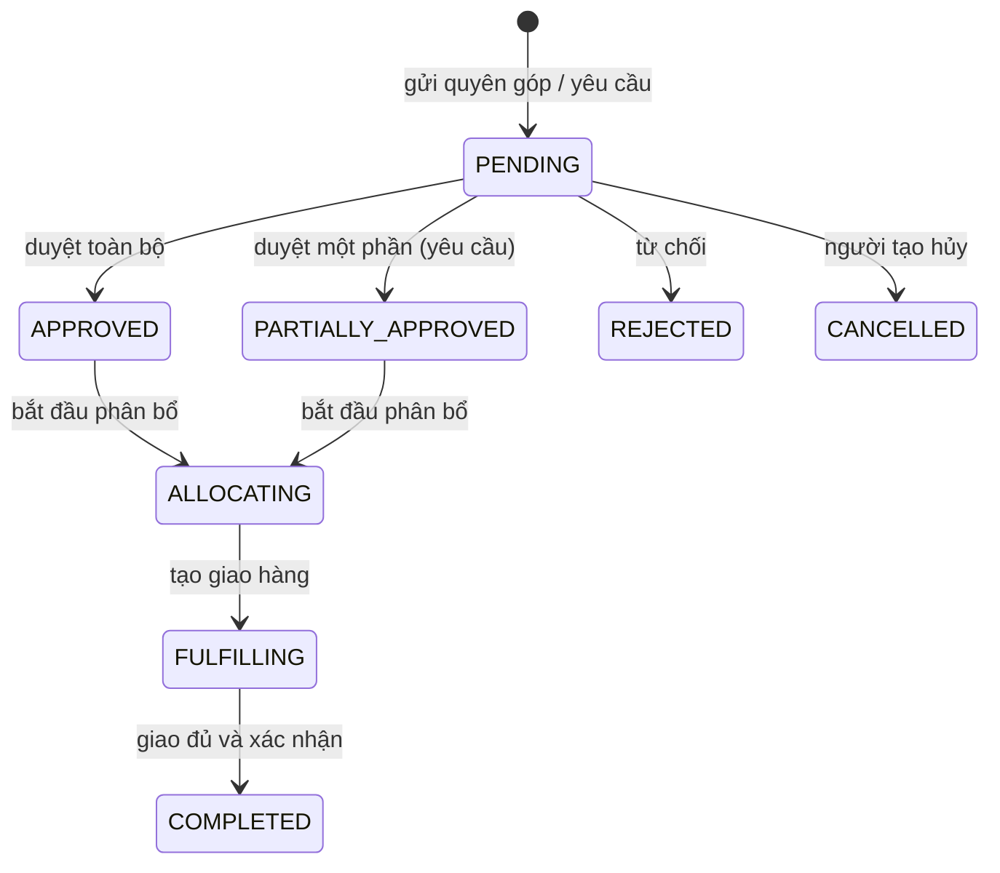

# Đặc tả Use Case — Coordination System

## 1. Phạm vi và căn cứ

Hệ thống hỗ trợ tiếp nhận nguồn lực cứu trợ, ghi nhận yêu cầu hỗ trợ, phân bổ hàng hóa và theo dõi giao nhận. Đặc tả này được suy ra từ lược đồ trong `sql/Coordination.sql`; mã nguồn hiện chưa có API hay nghiệp vụ triển khai. Các bước dưới đây là thiết kế đề xuất, không khẳng định hệ thống đã thực hiện chúng.

## 2. Tác nhân

| Tác nhân | Vai trò |
|---|---|
| Người dùng (USER) | Người quyên góp hoặc người nhận hỗ trợ; gửi và theo dõi hồ sơ của mình. |
| Điều phối viên (COORDINATOR) | Duyệt nguồn lực/yêu cầu, ghép nguồn hàng với nhu cầu, lập phân bổ và theo dõi thực hiện. |
| Quản trị viên (ADMIN) | Quản lý tài khoản, phân quyền, danh mục vật tư, đơn vị, điểm tập kết và đối tác vận chuyển. |
| Đối tác vận chuyển | Nhận thông tin lô hàng, cập nhật mã vận đơn và trạng thái giao hàng. Có thể tích hợp API hoặc cập nhật qua điều phối viên. |
| Người nhận được ủy quyền | Xác nhận đã nhận hàng, có thể cung cấp mã xác nhận và ảnh. |

Một tài khoản USER có thể vừa quyên góp vừa gửi yêu cầu hỗ trợ; schema chưa tách hai loại tài khoản này.

## 3. Sơ đồ use case

## 4. Đặc tả các use case chính

### UC-01 — Đăng nhập và quản lý hồ sơ

- **Tác nhân chính:** Người dùng, điều phối viên, quản trị viên.
- **Tiền điều kiện:** Tài khoản tồn tại và đang `ACTIVE`.
- **Luồng chính:** (1) Người dùng nhập email/mật khẩu. (2) Hệ thống xác thực. (3) Hệ thống kiểm tra trạng thái tài khoản và vai trò. (4) Cho phép truy cập chức năng theo quyền. (5) Người dùng xem/cập nhật thông tin cá nhân.
- **Ngoại lệ:** Sai thông tin đăng nhập; tài khoản `INACTIVE` hoặc `LOCKED`; yêu cầu cập nhật không hợp lệ.
- **Kết quả:** Phiên đăng nhập được tạo; hồ sơ được cập nhật nếu có.
- **Ghi chú:** Schema có `users`, `roles`, `user_roles`; cơ chế đăng ký, đặt lại mật khẩu và phiên đăng nhập chưa được mô tả.

### UC-02 — Gửi quyên góp / nguồn lực

- **Tác nhân chính:** Người dùng (người quyên góp).
- **Tiền điều kiện:** Đã đăng nhập; vật tư cần khai báo còn hoạt động.
- **Luồng chính:** (1) Chọn tạo quyên góp. (2) Nhập địa chỉ lấy hàng, loại nguồn (`DONATED`, `SPONSORED`, `PROVIDED`), ghi chú. (3) Thêm một hoặc nhiều vật tư, số lượng đề nghị, tình trạng và ảnh. (4) Gửi hồ sơ. (5) Hệ thống cấp mã quyên góp, đặt trạng thái `PENDING` và thông báo kết quả.
- **Ngoại lệ:** Thiếu địa chỉ/vật tư; số lượng không dương; vật tư không tồn tại hoặc ngừng hoạt động; tải ảnh thất bại.
- **Kết quả:** Hồ sơ và các dòng vật tư được lưu để chờ duyệt.
- **Luồng thay thế:** Chủ hồ sơ hủy khi còn ở trạng thái cho phép; hệ thống chuyển `CANCELLED`.

### UC-03 — Duyệt quyên góp và xác nhận hàng nhận

- **Tác nhân chính:** Điều phối viên.
- **Tiền điều kiện:** Có hồ sơ `PENDING`.
- **Luồng chính:** (1) Xem hồ sơ, vật tư, ảnh và thông tin người gửi. (2) Kiểm tra tính phù hợp. (3) Nhập số lượng chấp nhận cho từng vật tư. (4) Chấp nhận hoặc từ chối hồ sơ, ghi lý do. (5) Hệ thống lưu người duyệt/thời điểm và cập nhật trạng thái. (6) Khi hàng thực tế được bàn giao, điều phối viên cập nhật số lượng nhận và ghi nhận biến động nguồn lực.
- **Ngoại lệ:** Hồ sơ đã được xử lý; số lượng chấp nhận âm hoặc vượt số lượng đề nghị; số lượng nhận vượt số lượng được chấp nhận.
- **Kết quả:** Hồ sơ `APPROVED`/`REJECTED`; lượng được duyệt và nhận có thể tra cứu.
- **Lưu ý mô hình:** Bảng `donation_items` có `accepted_quantity`, `reserved_quantity`, `delivered_quantity`, nhưng thiếu trạng thái cấp dòng rõ ràng và lịch sử duyệt từng dòng.

### UC-04 — Tạo yêu cầu hỗ trợ

- **Tác nhân chính:** Người dùng (người cần hỗ trợ).
- **Tiền điều kiện:** Đã đăng nhập; có thông tin địa chỉ giao.
- **Luồng chính:** (1) Nhập tiêu đề, mô tả, địa chỉ, mức ưu tiên. (2) Thêm vật tư và số lượng mong muốn. (3) Gửi yêu cầu. (4) Hệ thống cấp mã, đặt `PENDING` và xác nhận gửi.
- **Ngoại lệ:** Thiếu tiêu đề/địa chỉ/vật tư; số lượng không dương; vật tư không hợp lệ.
- **Kết quả:** Yêu cầu được lưu và chờ duyệt.
- **Luồng thay thế:** Người tạo hủy yêu cầu khi chưa bắt đầu phân bổ và chính sách cho phép; trạng thái `CANCELLED`.

### UC-05 — Duyệt yêu cầu hỗ trợ

- **Tác nhân chính:** Điều phối viên.
- **Tiền điều kiện:** Yêu cầu ở trạng thái `PENDING`.
- **Luồng chính:** (1) Xem nội dung và các vật tư yêu cầu. (2) Đánh giá mức ưu tiên/tính hợp lệ. (3) Duyệt toàn bộ, duyệt một phần theo số lượng từng dòng hoặc từ chối và ghi lý do. (4) Hệ thống lưu người duyệt, thời điểm và trạng thái tương ứng (`APPROVED`, `PARTIALLY_APPROVED`, `REJECTED`). (5) Yêu cầu hợp lệ chuyển sang bước phân bổ.
- **Ngoại lệ:** Yêu cầu đã được xử lý; số lượng duyệt âm hoặc vượt số lượng yêu cầu.
- **Kết quả:** Yêu cầu có lượng được duyệt rõ ràng làm căn cứ phân bổ.

### UC-06 — Phân bổ nguồn lực cho yêu cầu

- **Tác nhân chính:** Điều phối viên.
- **Tiền điều kiện:** Yêu cầu đã duyệt; có nguồn hàng đã nhận và còn khả dụng.
- **Luồng chính:** (1) Mở yêu cầu cần xử lý. (2) Xem lượng đã duyệt và nguồn hàng khả dụng theo vật tư. (3) Chọn các dòng nguồn hàng và số lượng cấp cho từng dòng yêu cầu. (4) Hệ thống kiểm tra đúng loại vật tư, không vượt nhu cầu còn thiếu và lượng chưa phân bổ. (5) Tạo mã phân bổ cùng các dòng phân bổ. (6) Giữ chỗ số lượng nguồn hàng và cập nhật trạng thái yêu cầu/phân bổ.
- **Ngoại lệ:** Không còn đủ hàng; số lượng vượt tồn/nhu cầu; nguồn hàng đã bị giữ bởi phân bổ khác; điều phối viên không có quyền.
- **Kết quả:** Phân bổ ở `PENDING` hoặc `APPROVED`; lịch sử nguồn hàng được ghi nhận.
- **Quy tắc cần chốt:** Phải định nghĩa rõ thời điểm trừ/giữ tồn và cách hoàn tồn khi phân bổ bị hủy. Schema có `reserved_quantity` và `supply_movements` nhưng chưa nêu quy tắc giao dịch.

### UC-07 — Lập và theo dõi giao hàng

- **Tác nhân chính:** Điều phối viên; đối tác vận chuyển là tác nhân phụ.
- **Tiền điều kiện:** Có phân bổ được chấp thuận và hàng sẵn sàng giao.
- **Luồng chính:** (1) Tạo chuyến giao từ một hay nhiều dòng phân bổ. (2) Nhập địa chỉ lấy/giao và chọn đối tác nếu có. (3) Hệ thống tạo mã chuyến và danh sách hàng. (4) Đối tác/điều phối viên cập nhật mã vận đơn, URL theo dõi và trạng thái. (5) Mỗi lần đổi trạng thái, hệ thống lưu sự kiện, thời điểm, vị trí và người cập nhật. (6) Khi giao xong, chuyển `DELIVERED`.
- **Ngoại lệ:** Đối tác không khả dụng; mã vận đơn lỗi; giao thất bại, hủy hoặc hoàn hàng; cập nhật trạng thái không hợp lệ.
- **Kết quả:** Người dùng và điều phối viên xem được tiến trình giao hàng.
- **Trạng thái gợi ý:** `PENDING → BOOKED → PICKED_UP → IN_TRANSIT → OUT_FOR_DELIVERY → DELIVERED`; nhánh lỗi: `FAILED`, `CANCELLED`, `RETURNED`.

### UC-08 — Xác nhận nhận hàng

- **Tác nhân chính:** Người nhận được ủy quyền.
- **Tiền điều kiện:** Chuyến giao đang giao hoặc đã giao; người xác nhận có quyền xác nhận cho yêu cầu tương ứng.
- **Luồng chính:** (1) Người nhận kiểm tra hàng. (2) Xác nhận người nhận, mã xác nhận (nếu áp dụng), ghi chú và ảnh. (3) Hệ thống kiểm tra chuyến chưa có xác nhận. (4) Lưu xác nhận và thời điểm; cập nhật phân bổ/yêu cầu hoàn tất khi mọi dòng đã giao.
- **Ngoại lệ:** Mã xác nhận không hợp lệ; thiếu quyền; chuyến đã được xác nhận; hàng thiếu/hư hỏng được ghi nhận để xử lý.
- **Kết quả:** Có bằng chứng giao nhận và trạng thái hoàn tất phù hợp.

### UC-09 — Quản trị danh mục và cấu hình

- **Tác nhân chính:** Quản trị viên.
- **Tiền điều kiện:** Đã đăng nhập với quyền `ADMIN`.
- **Luồng chính:** (1) Quản lý người dùng và vai trò. (2) Tạo/cập nhật danh mục, đơn vị tính và vật tư. (3) Quản lý điểm tập kết và đối tác vận chuyển. (4) Ngừng hoạt động thay vì xóa cấu hình đã được tham chiếu. (5) Hệ thống kiểm tra ràng buộc và lưu thay đổi.
- **Ngoại lệ:** Tên/mã trùng; bản ghi đang được tham chiếu; dữ liệu không hợp lệ; tài khoản không đủ quyền.
- **Kết quả:** Danh mục và cấu hình sẵn sàng cho các luồng nghiệp vụ.

### UC-10 — Tra cứu tình trạng nguồn lực và hồ sơ

- **Tác nhân chính:** Người dùng, điều phối viên, quản trị viên.
- **Luồng chính:** (1) Tra cứu theo mã, trạng thái, vật tư, thời gian hoặc người tạo tùy quyền. (2) Hệ thống hiển thị trạng thái, số lượng, lịch sử liên quan và thông tin vận chuyển. (3) Người dùng chỉ xem hồ sơ của mình; điều phối viên xem các hồ sơ thuộc phạm vi công việc; quản trị viên xem toàn hệ thống.
- **Kết quả:** Người dùng biết tiến độ; điều phối viên nhìn được nguồn hàng và nhu cầu để xử lý.
- **Lưu ý:** Quyền xem theo phạm vi cần được xác định trong authorization; schema chưa quy định.

## 5. Quy tắc nghiệp vụ đề xuất

1. Mọi số lượng nhập phải lớn hơn 0; số lượng duyệt không vượt số lượng yêu cầu/đề nghị. Một số ràng buộc đã có trong SQL.
2. Chỉ vật tư `ACTIVE` được dùng trong hồ sơ mới; hồ sơ cũ vẫn phải xem được khi vật tư ngừng hoạt động.
3. Chỉ điều phối viên được duyệt, phân bổ và cập nhật vận hành; chỉ quản trị viên được cấp quyền và cấu hình hệ thống.
4. Không phân bổ vượt số lượng đã duyệt hoặc nguồn hàng khả dụng; cập nhật tồn và tạo phân bổ cần thực hiện nguyên tử để tránh cấp trùng.
5. Mỗi chuyến giao chỉ có một xác nhận giao hàng; schema đang áp dụng `UNIQUE(shipment_id)`.
6. Thay đổi trạng thái cần lưu người thực hiện và dấu thời gian; bảng `shipment_events` đã hỗ trợ một phần.
7. Các hành động từ chối, hủy, giao thất bại nên bắt buộc có lý do và lưu lịch sử.

## 6. Trạng thái vòng đời tổng quát

Sơ đồ trên mô tả yêu cầu hỗ trợ; quyên góp có vòng đời riêng `PENDING → APPROVED/REJECTED/CANCELLED → COMPLETED` khi việc nhận hàng hoàn tất.

## 7. Điểm còn thiếu để chốt thiết kế

- Chưa có quy định đăng ký, xác minh tài khoản, quên mật khẩu và khóa/mở tài khoản.
- Chưa có bảng lưu lý do duyệt/từ chối/hủy, lịch sử trạng thái cho quyên góp và yêu cầu.
- Chưa xác định mô hình tồn kho theo điểm tập kết; `collection_points` chưa liên kết trực tiếp với dòng hàng.
- Chưa xác định một phân bổ có thể tạo nhiều chuyến giao hay một chuyến giao gom nhiều yêu cầu.
- Chưa có cơ chế kiểm chứng quyền người nhận và xác thực mã giao hàng.
- Chưa mô tả thông báo, báo cáo, tìm kiếm và SLA xử lý.
- `attachments` dùng liên kết owner đa hình nên cần quy tắc kiểm tra quyền truy cập tệp ở tầng ứng dụng.

## 8. Ưu tiên triển khai

1. Đăng nhập, vai trò và hồ sơ.
2. Tạo/duyệt quyên góp; ghi nhận lượng thực nhận.
3. Tạo/duyệt yêu cầu hỗ trợ.
4. Phân bổ có khóa tồn và lịch sử biến động.
5. Tạo chuyến giao, cập nhật sự kiện và xác nhận nhận hàng.
6. Màn hình quản trị danh mục, điểm tập kết, đối tác và báo cáo.
